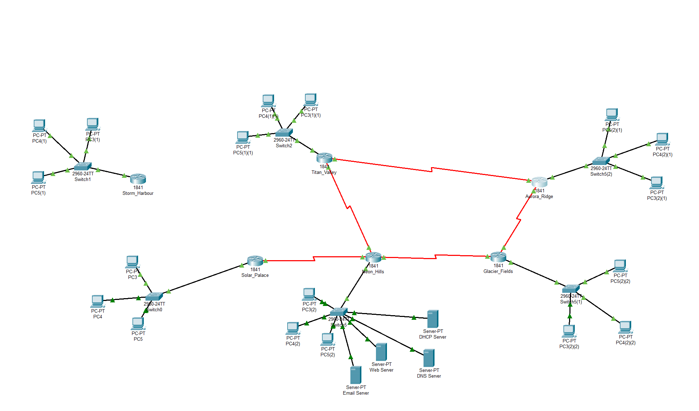

# Crystal Empire Network: Multi-Site WAN Design in Cisco Packet Tracer

A six-site enterprise network designed and simulated in Cisco Packet Tracer. It covers VLSM subnetting from a single /16 block, serial WAN links, static, floating-static and RIPv2 routing, and centralised DHCP, DNS, Web and Email services. Built for a Computer Networks course (Group 207).

## Overview

The Crystal Empire network connects six sites: **Titan Valley, Storm Harbour, Glacier Fields, Aurora Ridge, Neon Hills and Solar Palace**. Neon Hills is the central hub and hosts the shared server farm. The design starts from the major network `18.69.0.0/16` and allocates address space per site with VLSM to minimise waste.

## Topology



- 6 × Cisco 1841 routers
- 2960-24TT switches with end-user PCs at each site
- Server farm at Neon Hills: DHCP, DNS, Web and Email
- Serial WAN links between routers (WAN1 to WAN5)
- A redundant ring, Titan Valley – Aurora Ridge – Glacier Fields – Neon Hills, for failover

## Addressing Plan (VLSM)

| Subnet | Needed | Allocated | Network | Mask |
|---|---|---|---|---|
| Titan Valley | 4052 | 4094 | 18.69.0.0 | /20 |
| Storm Harbour | 902 | 1022 | 18.69.16.0 | /22 |
| Glacier Fields | 352 | 510 | 18.69.20.0 | /23 |
| Aurora Ridge | 152 | 254 | 18.69.22.0 | /24 |
| Neon Hills | 132 | 254 | 18.69.23.0 | /24 |
| Solar Palace | 42 | 62 | 18.69.24.0 | /26 |
| WAN1 (Solar – Neon) | 2 | 2 | 18.69.24.64 | /30 |
| WAN2 (Neon – Titan) | 2 | 2 | 18.69.24.68 | /30 |
| WAN3 (Titan – Aurora) | 2 | 2 | 18.69.24.72 | /30 |
| WAN4 (Aurora – Glacier) | 2 | 2 | 18.69.30.0 | /30 |
| WAN5 (Neon – Glacier) | 2 | 2 | 18.69.30.4 | /30 |

Subnets are allocated largest-first to avoid overlap and fragmentation.

## Features

### Routing
- **Static routing** between Solar Palace, Neon Hills and Titan Valley.
- **Floating static route** (administrative distance 150) as a backup path for the Neon Hills LAN via the Titan – Aurora link.
- **Dynamic routing with RIPv2** (`version 2`, `no auto-summary`) across Titan Valley, Aurora Ridge, Glacier Fields and Neon Hills.

### Services
- **DHCP** at Neon Hills (`18.69.23.10`) with pools for Glacier Fields and Aurora Ridge. Routers use `ip helper-address` to relay requests across subnets.
- **DNS** (`18.69.23.2`), **Web** (`18.69.23.3`) and **Email** (`18.69.23.5`) servers.
- Other sites use static host addressing. Glacier Fields and Aurora Ridge clients get addresses via DHCP.

## Sample Configuration

```
! DHCP pool on Neon Hills
ip dhcp pool GLACIER_FIELDS
 network 18.69.20.0 255.255.254.0
 default-router 18.69.20.1
 dns-server 18.69.23.2

! DHCP relay on the client-facing router
interface FastEthernet0/1
 ip address 18.69.20.1 255.255.254.0
 ip helper-address 18.69.23.10

! RIPv2
router rip
 version 2
 network 18.0.0.0
 no auto-summary

! Floating static backup route
ip route 18.69.23.0 255.255.255.0 18.69.24.73 150
```

## Testing
- Ping and traceroute between LANs at every site
- DHCP lease verification on Glacier Fields and Aurora Ridge clients
- Failover test: shut down a primary WAN link and confirm the floating static route takes over
- Routing tables checked with `show ip route`

## Tools
Cisco Packet Tracer · Cisco IOS CLI · VLSM · RIPv2 · Static/Floating Static Routing · DHCP · DNS

## Team
| Name | ID | Contribution |
|---|---|---|
| Khan Farhan Mahdi | 22201698 | Web/Email/DNS servers, floating static routing, topology diagram |
| Shahriar Mohammad | 22299020 | VLSM calculation, IP address table, routing verification, VLSM diagram |
| Ameet Faisal | 22201869 | DHCP, static and dynamic routing, IP assignment, subnetting, documentation |

## Repository Contents
- `421_Project/`: Packet Tracer project files
- `Topology.png`: network topology
- `207.pdf`: full report (VLSM tree, IP table, configs)